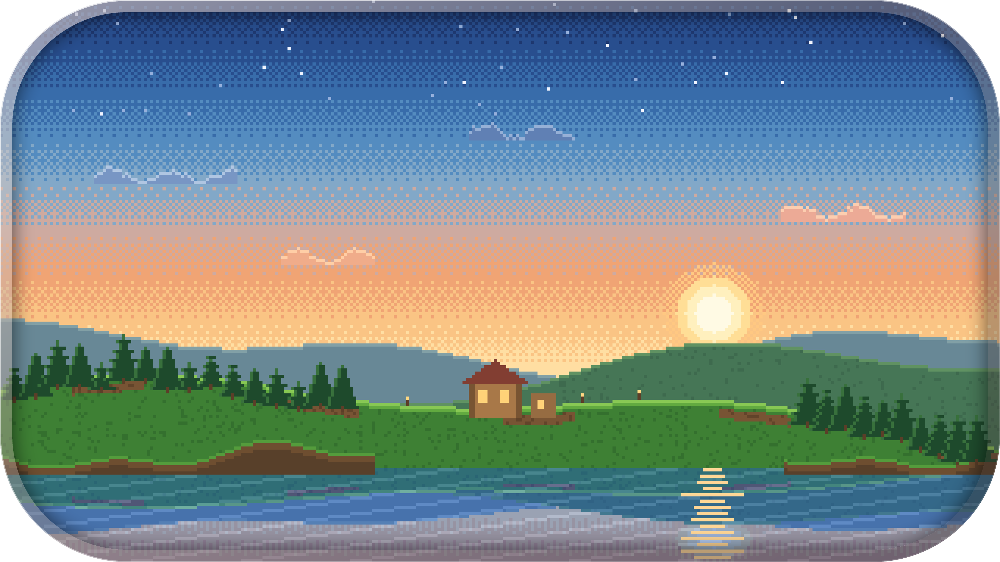
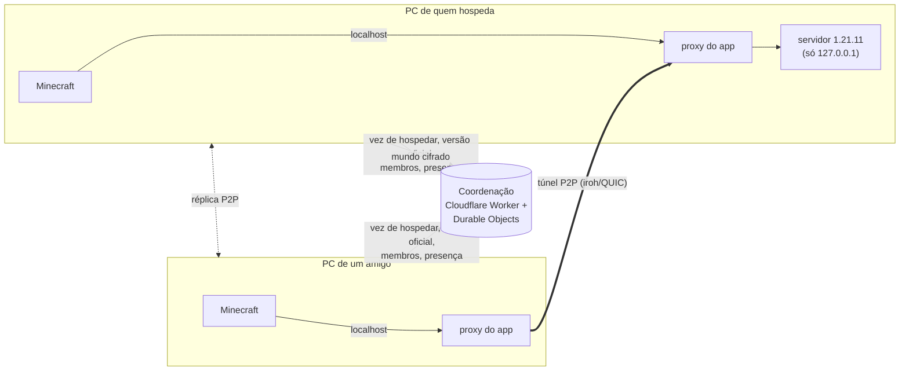

<p align="center"></p>

# Machen Craft

O app que mantém o mundo de Minecraft da turma sempre no ar entre amigos, sem pagar host e sem ninguém mexer em rede. O mundo configurado hoje é o **pAuletOr 3**.

- **Um botão:** quem clica em **Jogar** entra no mundo. Se alguém já hospeda, o app leva até ele; se ninguém hospeda, o mundo acorda no PC de quem clicou.
- **Sempre o mesmo endereço:** no Minecraft, o mundo é `localhost` (entrada com o nome do mundo, **pAuletOr 3**, no Multiplayer). O app de cada PC encaminha para quem estiver hospedando.
- **Troca automática de host:** se o host cai (luz, internet, PC desligado), um amigo que estava jogando assume sozinho, a partir do último salvamento (no máximo 1–5 min de perda, configurável).
- **Nada de VPN, porta, IP ou conta de terceiros para os amigos:** a rede P2P (iroh) vem embutida no app; o amigo só abre o link do convite.
- **Mundo protegido:** cópia em cada PC da turma + cópia cifrada na nuvem do dono (Cloudflare grátis). Versões nunca são apagadas sem regra; dá para restaurar qualquer uma.
- **Jogabilidade 100% vanilla:** Minecraft Java **1.21.11**, servidor Fabric + Lithium (só no servidor), cliente vanilla.

Não afiliado à Mojang nem à Microsoft.

## Como funciona



Detalhes em [docs/arquitetura.md](docs/arquitetura.md).

## Primeira vez (dono, uma vez só)

1. **Publicar a coordenação** na sua conta grátis da Cloudflare (o navegador abre para você entrar; sem cartão):
   ```powershell
   powershell -ExecutionPolicy Bypass -File scripts\publicar-coordenacao.ps1
   ```
   No fim aparecem o **endereço** e a **chave de administração** (guardados em `scripts\.cache\coordenacao.txt`, fora do Git).
2. **Publicar o instalador** no seu Worker (os amigos baixam pelo convite, e as atualizações chegam sozinhas):
   ```powershell
   powershell -ExecutionPolicy Bypass -File scripts\publicar-app.ps1
   ```
3. Instalar o app, escolher **Vou criar o mundo**, colar endereço e chave, importar a pasta do mundo e **mandar o link do convite** no WhatsApp.

## Amigos

Abrem o link no PC → baixam e instalam → **Abrir convite no app** → escolhem o nick → **Jogar**. Manual: [docs/manual-do-jogador.md](docs/manual-do-jogador.md).

## Estrutura

```
core/          machencraft-core: sincronização, vez de hospedar, P2P, proxy, servidor, sessão (Rust)
  src/bin/     machencraft-cli: a mesma lógica pela linha de comando
  tests/       integração (rede simulada) e contrato com o Worker
coordinator/   coordenação (Cloudflare Worker + Durable Objects, TypeScript)
app/           app desktop (Tauri 2 + React + TypeScript + Tailwind)
scripts/       publicar-coordenacao.ps1, publicar-app.ps1, e2e-failover.sh, e2e-troca.sh, robo-jogador.py
docs/          documentação
identidade/    logo, ícone e cena em pixel art (arte final do Machen Craft)
legacy/        projeto antigo, só referência (a v1 está na tag v1-final)
```

## Desenvolvimento

Pré-requisitos: Rust stable (MSVC), Build Tools do Visual Studio, Node 22+. Neste PC ficam em `D:\DevTools`.

```powershell
cargo test -p machencraft-core                                  # unitários + integração
cargo clippy --workspace --all-targets -- -D warnings
cd coordinator; npm ci; npx tsc --noEmit; npx vitest run      # Worker
cd app; npm ci; npm run typecheck; npm run lint; npm run build # interface
cd app; npx tauri dev --features personal                     # app em desenvolvimento
python -I scripts/gerar-icones.py                             # ícones e cena a partir de identidade/
```

Para revisar o visual sem tocar em dados reais: `cd app; npx vite` e abra `http://localhost:1420/?mock=livre` (também `aberto`, `preparando`, `host`, `assistente`; `&page=stats` etc. abre outra aba). O modo simulado só existe no `npm run dev`.

**Identidade:** títulos em Jersey 10 (pixel), interface em Figtree; as cores saem da cena (`identidade/`). A luz da janela é a cor de ação; a casa da cena acende quando o mundo está aberto e apaga quando está livre.

Contrato Rust ↔ Worker e teste de ponta a ponta com servidor real:

```bash
cd coordinator && npx wrangler dev --local --port 8787        # ADMIN_TOKEN em coordinator/.dev.vars
P3_COORD_URL=http://127.0.0.1:8787 P3_ADMIN=dev-admin-local cargo test -p machencraft-core --test contract_http
bash scripts/e2e-failover.sh                                  # queda do host + troca automática, medida
bash scripts/e2e-troca.sh                                     # Parar com amigo jogando: host passa sem derrubar ninguém
```

### Builds

- **Pessoal** (`--features personal`): servidor em modo offline, para o grupo dos autores (amigos com TLauncher). Distribuído só pelo Worker do dono, para quem tem convite.
- **Padrão**: servidor com `online-mode=true` (exige conta original).

### CLI

```text
machencraft-cli create-world | join <convite> | invite | members | approve | remove
machencraft-cli up [--play] | play | status | health | diagnose | diary | timeline
machencraft-cli restore <id> | gc | pull | prepare | import <pasta> | players | migrate-player
```
