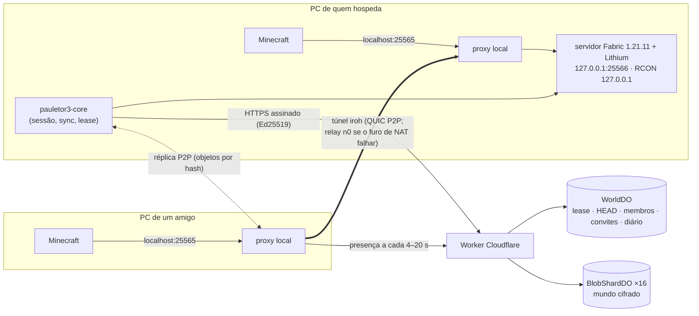
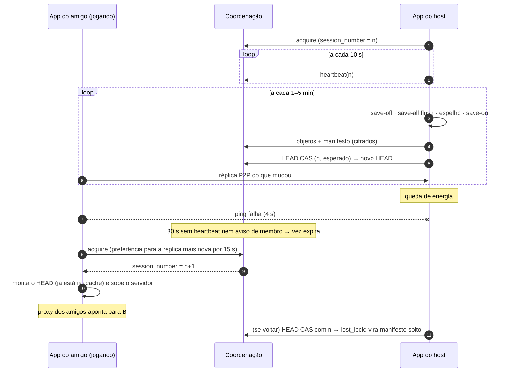

# Arquitetura (v2)

## Peças

| Peça | O que faz |
|---|---|
| `core/src/coord` | Contrato da coordenação (`Coordinator`), regras puras (`rules.rs`), implementação em memória (testes) e cliente HTTP. |
| `core/src/lease.rs` | Posse da vez: heartbeat a cada 10 s, detecção de vez perdida e de isolamento. |
| `core/src/sync.rs` | Modelo endereçado por conteúdo (objetos sha256 + manifestos). HEAD só muda por CAS na coordenação, por último. Busca objetos nos amigos (P2P) antes da nuvem. |
| `core/src/p2p.rs` | Nó iroh: ALPN `pauletor3/mc/1` (túnel do jogo) e `pauletor3/sync/1` (manifestos, objetos, ping). Só membros conectam. |
| `core/src/proxy.rs` | Proxy em `127.0.0.1`: lê o handshake do Minecraft e encaminha (local, túnel) ou responde o MOTD/aviso e acorda o mundo. |
| `core/src/remote/crypt.rs` | Cifra XChaCha20-Poly1305 com a chave do mundo (viaja só no `#` do convite). |
| `core/src/session.rs` | Orquestra jogar, checkpoints, fim de sessão, recuperação, failover, réplica em segundo plano. |
| `coordinator/` | Worker + Durable Objects (SQLite). Um `WorldDO` por mundo serializa as operações (CAS de verdade). |

## Sessão e failover

## Regras de segurança do mundo

- **Nunca dois hosts:** a coordenação concede uma vez por vez (DO serializado). O host que perde contato por 25 s sem amigos conectados se encerra sozinho; com amigos conectados, eles “avisam” que o host vive e a vez não expira.
- **Réplica velha nunca vence:** publicar exige o HEAD esperado e o `session_number` atual.
- **Nada corrompe o oficial:** objetos conferidos por hash ao receber; HEAD gravado por último; montagem com troca atômica.

## Custos (plano grátis da Cloudflare)

Presença devolve a fotografia do mundo (1 pedido por ciclo); presença só em memória; heartbeat no disco no máximo a cada 15 s. Estimativa para 3–5 amigos: < 30 mil pedidos/dia (limite 100 mil) e < 20 mil linhas gravadas/dia (limite 100 mil). Armazenamento: até 4 GB por mundo (limite da conta: 5 GB).
