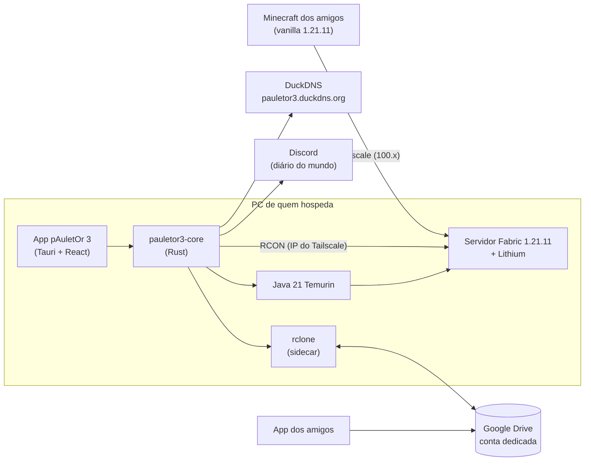
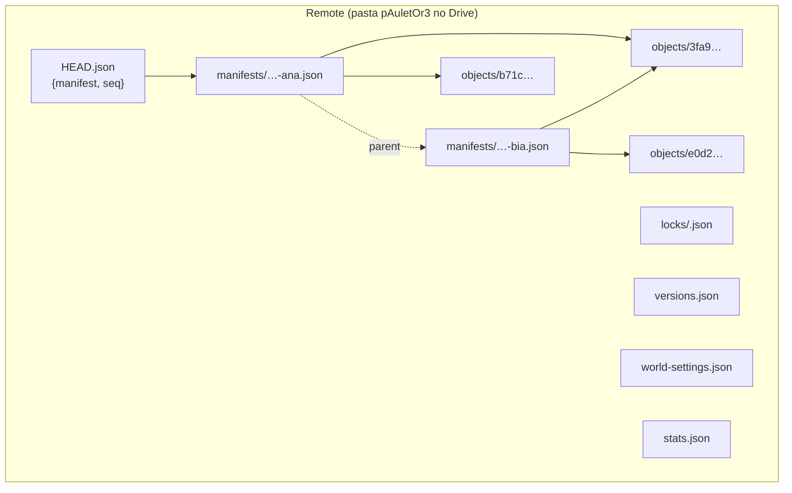
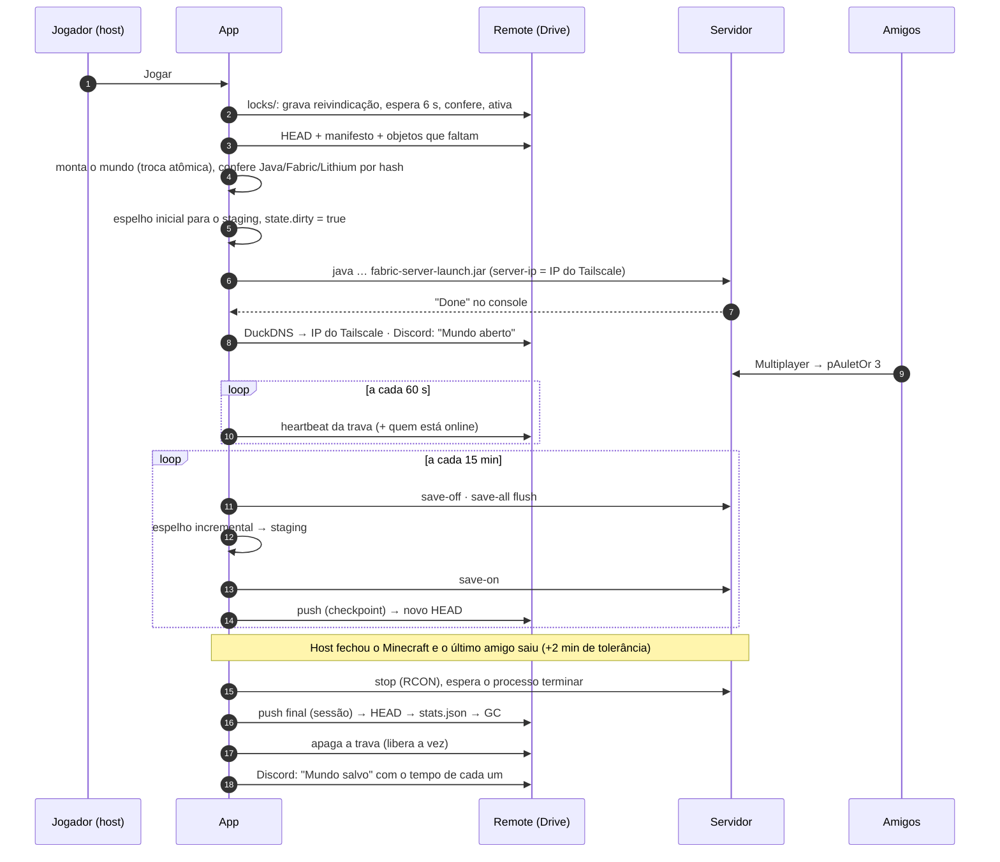

# Arquitetura

## Visão geral



- **`core/`** (`pauletor3-core`): toda a lógica, sem dependência de interface, mais a CLI `pauletor3-cli`.
- **`app/`**: Tauri 2 (Rust) + React/TypeScript/Tailwind. Fica com a bandeja, as notificações, o autostart, o updater e o bloqueio do desligamento do Windows.

## Modelo de sincronização



| Arquivo | Conteúdo |
|---|---|
| `objects/<sha256>` | Cada arquivo do mundo (região, `level.dat`, playerdata…), guardado uma vez, pelo hash. Arquivos iguais nunca são reenviados. |
| `manifests/<data>-<host>-<id>.json` | Mapa caminho → `{hash, tamanho, mtime}` de uma versão completa, com metadados: tipo, host, sessão, duração, jogadores, versões, `parent`. |
| `HEAD.json` | Aponta para o manifesto atual. **Gravado por último**, depois de todos os objetos confirmados no remote. |
| `locks/<sessão>.json` | Reivindicação de vez (ver abaixo). |
| `versions.json` | Versões fixadas com hashes; a fonte da verdade para todos. |
| `world-settings.json` | Dificuldade, modo, distâncias, MOTD, seed. |
| `stats.json` | Estatísticas, resumo diário e marcos (só o dono da vez grava). |

### Envio (push)

1. Varre o staging; o hash só é recalculado se tamanho ou mtime (ns) mudou.
2. Cada objeto vai para `cache/objects/<sha256>` (hardlink).
3. Lista `objects/` no remote e calcula o que falta.
4. Reconfere o sha256 de cada objeto que vai subir.
5. Envia em lote (`rclone copy --files-from-raw --no-traverse`, 4 transferências).
6. Lista de novo e confirma **todos** os objetos do manifesto, com o tamanho certo.
7. Grava o manifesto, relê e compara byte a byte.
8. Confere a vez (`LockGuard::verify`) e se o HEAD ainda é o esperado. Só então grava o HEAD e relê.

Se qualquer passo falha antes do 8, o HEAD não muda. Objetos que chegaram ficam como lixo até o próximo GC.

### Download (pull)

1. Lê o HEAD e o manifesto (manifestos são imutáveis e ficam em cache).
2. Baixa os objetos que faltam para uma pasta temporária e confere o sha256 de cada um. Se algum não bater, tenta de novo uma vez; se persistir, aborta **sem tocar no mundo local**.
3. Monta o mundo em `incoming/montagem-…`, conferindo o hash de novo durante a cópia, e restaura os mtimes.
4. Troca atômica: `world` → `world.antigo-…`, montagem → `world`, apaga a antiga. Se a luz cair no meio, `repair_interrupted_swap` devolve a pasta anterior ao abrir.

### Retenção e GC

Mantém: o HEAD, o último manifesto de cada uma das **20 últimas sessões** e o último de **cada dia dos últimos 30 dias**. O GC apaga primeiro os manifestos fora da lista e depois os objetos sem referência. Ele só roda com a vez em mãos (ninguém hospedando), no fim de uma sessão (no máximo uma vez a cada 20 h) ou manualmente. Se algum manifesto estiver ilegível, o GC não apaga nada.

## Ciclo de uma sessão



### Passar a vez

O host marca `handing_over` na trava, avisa no chat com contagem de 30 s, encerra e envia. No app dos amigos aparece **Assumir agora**: o app espera a trava sumir e então executa o fluxo de Jogar. Todos reconectam no mesmo endereço (o DuckDNS passa a apontar para o novo host).

### Quedas

- **Do host, vista pelos amigos:** a trava fica "velha" quando o heartbeat tem mais de 5 min **e** a porta do jogo no IP do dono não responde. Aí o app oferece "Assumir o mundo", com explicação; nunca assume sozinho.
- **Do próprio host:** ao reabrir, o app recupera. Envia o mundo local como "Recuperado após queda" e só publica como HEAD se ninguém tiver assumido depois. Ver [decisoes.md](decisoes.md#35-recuperação-de-queda).
- **Desligamento do Windows:** `WM_QUERYENDSESSION` → `ShutdownBlockReasonCreate("Salvando o mundo pAuletOr 3…")` → encerra a sessão → libera o desligamento.

## Pastas locais (na pasta de dados escolhida)

```
pAuletOr3/
  config.json          configuração deste PC (sem segredos)
  secrets.bin          segredos (DPAPI)
  rclone.conf          config do rclone (criptografada pelo rclone)
  state.json           qual manifesto o mundo local representa; sessão ativa
  journal-queue.json   fila do diário do Discord
  runtime/java-…       Java 21
  server/              servidor (Fabric, Lithium, world/, logs/)
  staging/             espelho consistente do mundo (origem dos envios)
  cache/objects/       objetos por hash; cache/manifests/
  recovered/           cópias de segurança de pastas substituídas
  backups/             backups do servers.dat
  logs/                logs do app (JSON, rotação diária, 14 dias) + console do servidor
```
