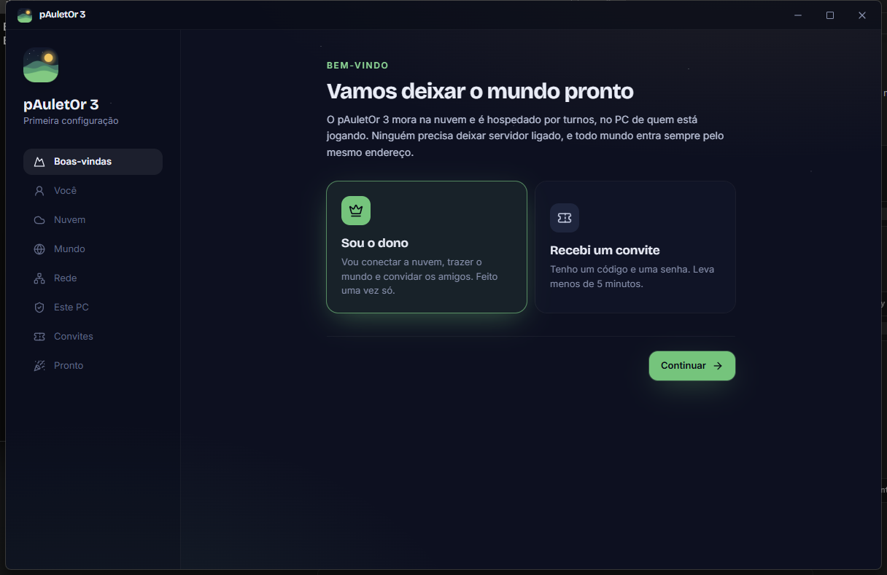
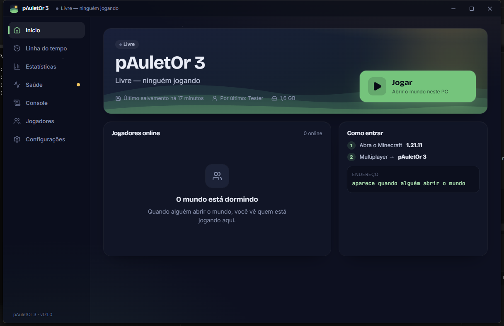
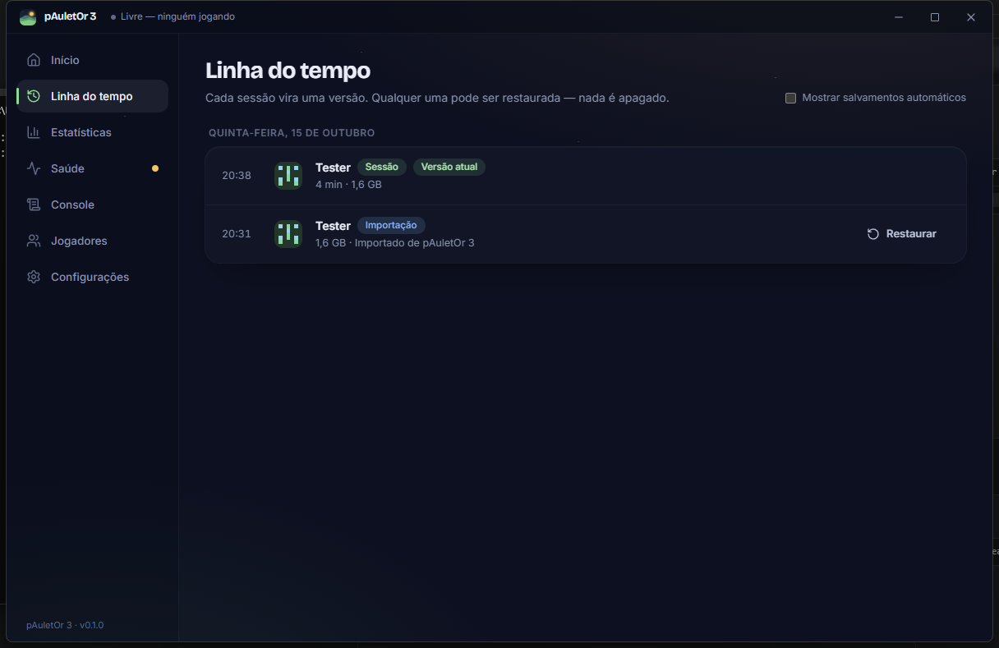
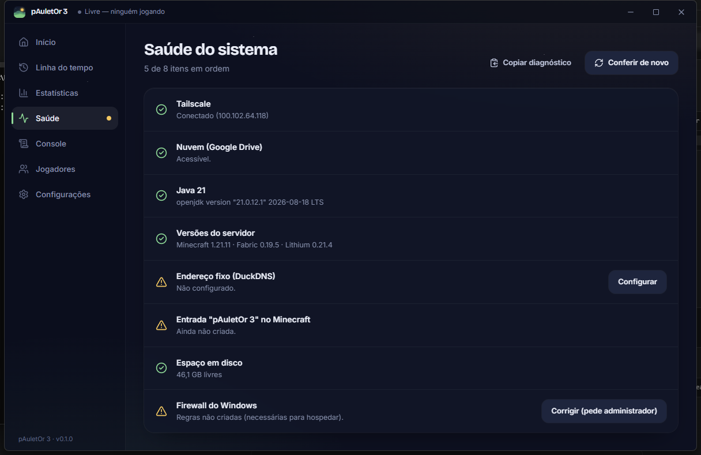
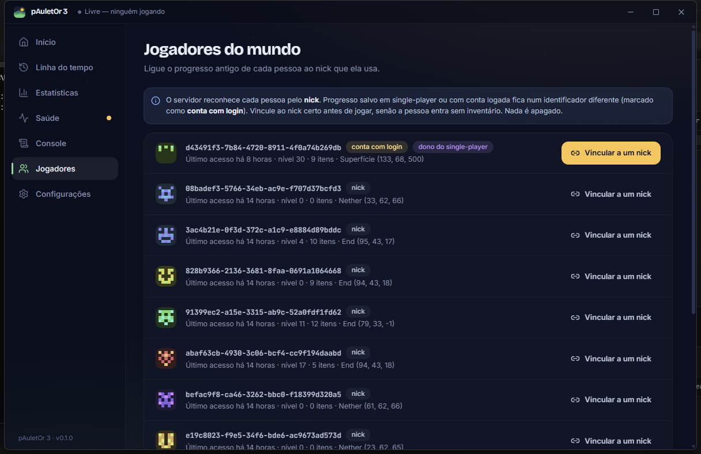

# Manual do jogador — pAuletOr 3

O pAuletOr 3 é o nosso mundo de Minecraft. Ele mora na nuvem, e quem quer jogar vira o "servidor" na hora, no próprio PC. Ninguém precisa deixar nada ligado.

## Instalar (uma vez só, menos de 5 minutos)

1. Baixe o instalador **pAuletOr 3_x.y.z_x64-setup.exe** (o link vem do dono) e instale.
2. Abra o app e escolha **Recebi um convite**.
3. Digite o seu **nick exatamente como no Minecraft**.
4. Escolha onde guardar os dados. O app sugere o disco com mais espaço; deixe uns 5 GB livres.
5. Marque o **EULA do Minecraft** e continue.
6. Cole o **código de convite** (começa com `P3.`) e a **senha** que o dono te passou.
7. Se não tiver o Tailscale, clique em **Instalar o Tailscale** e aceite a permissão do Windows. Depois clique em **Entrar na rede do mundo**.
8. Em **Preparar este PC**, clique nos três botões:
   - **Firewall**: pede permissão de administrador uma vez.
   - **Entrada no Minecraft**: feche o Minecraft antes.
   - **Java e servidor**: baixa uns 110 MB.
9. **Abrir o pAuletOr 3.** Pronto.

## Jogar

O botão grande muda conforme o momento:

| O botão diz | O que acontece |
|---|---|
| **Jogar** | Ninguém está jogando. O app baixa o mundo, abre o servidor no seu PC, avisa todo mundo e abre o Minecraft. |
| **Entrar no mundo do Fulano** | Alguém já está hospedando. Abra o Minecraft → **Multiplayer → pAuletOr 3**. |
| **Assumir agora** | Quem hospedava vai sair e passou a vez. Um clique e o mundo continua no seu PC. |
| **Assumir o mundo** | O PC de quem hospedava caiu (luz, internet). O app explica o que houve antes de você confirmar. |
| **Recuperar sessão** | O seu PC caiu enquanto você hospedava. Clique para enviar o que ficou salvo nele. |

No Minecraft é sempre igual: versão **1.21.11**, **Multiplayer → pAuletOr 3**. Funciona com o launcher oficial e com o TLauncher, sem mods.

## Quando você está hospedando

- O mundo é **salvo na nuvem a cada 15 minutos**. Numa queda de luz, perde-se no máximo isso.
- Pode **fechar o seu Minecraft** à vontade. Se ainda houver amigos jogando, o servidor continua e o app avisa: *"Seus amigos ainda estão jogando, não desligue o PC"*. Quando o último sair, o mundo é salvo e fechado sozinho.
- **Precisa sair, mas o pessoal quer continuar?** Clique em **Passar a vez**. Todo mundo vê uma contagem no chat, o mundo é salvo e qualquer um clica em **Assumir agora**.
- **Vai desligar o PC?** Pode. O app segura o desligamento por alguns instantes com a mensagem *"Salvando o mundo pAuletOr 3…"* e libera quando terminar. **Não force o desligamento.**
- O ícone na bandeja (perto do relógio) mostra o estado. Verde: você está hospedando. Amarelo: ocupado (salvando ou baixando).

## Linha do tempo

Cada sessão vira uma versão do mundo. Se algo der muito errado (alguém explodiu a base, um bug, um susto), dá para **restaurar** uma versão antiga. Isso cria uma versão nova igual à escolhida, e nada é apagado: dá para desfazer. Só funciona com ninguém jogando.

## Saúde do sistema

Uma lista com verde, amarelo e vermelho. Cada item com problema tem um botão para corrigir. Se ainda assim algo não funcionar, clique em **Copiar diagnóstico** e cole na conversa com o dono. O relatório já vem sem senhas, tokens e IPs.

## Jogadores (dono)

O servidor reconhece cada pessoa pelo **nick**. Quem jogou no single-player ou com conta logada tem o progresso guardado de outro jeito (marcado como **conta com login**). Antes da primeira partida, o dono clica em **Vincular a um nick** em cada uma dessas linhas e digita o nick da pessoa. Assim ela entra com o inventário, a posição e as conquistas de antes.

## O diário no Discord

O canal do Discord vira a história do mundo: quem abriu e fechou, quem entrou e saiu, mortes, conquistas, a primeira ida ao Nether e ao End, o dragão, recordes, aniversários do mundo e um resumo no fim do dia. Cada tipo de aviso pode ser ligado ou desligado em **Configurações → Diário do mundo**. As mensagens de chat vêm desligadas.

## Perguntas rápidas

- **Dois podem clicar em Jogar ao mesmo tempo?** Pode clicar, mas só um vira host. O outro vê *"Fulano já está hospedando"* e entra como jogador.
- **O endereço muda?** Não. É sempre **pAuletOr 3** na lista do Multiplayer.
- **Preciso deixar o app aberto?** Ele fica na bandeja e abre com o Windows. Assim ele te avisa quando alguém abrir o mundo.
- **Mudou a versão do Minecraft?** Não atualize o jogo por conta própria: o mundo é **1.21.11** e o app só hospeda nessa versão.
